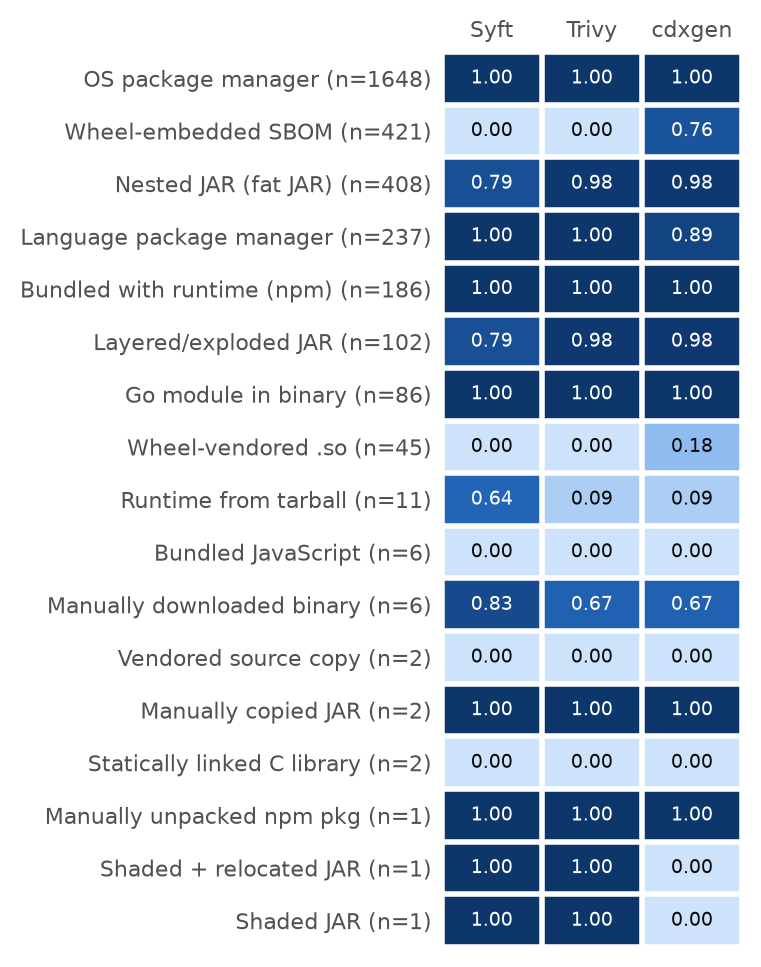

<p align="left">
  
  
  
  
  
  
  
  
</p>

---

# Same App, Different SBOM: Syft vs Trivy vs cdxgen

## Project Overview

A **Software Bill of Materials (SBOM)** lists every component inside a piece of software. It is the basis for vulnerability management and is becoming a legal requirement, for example under the EU Cyber Resilience Act. Different SBOM generators produce different component lists for the same software, and it is rarely measured **which list is right**.

This project is a **comparative measurement study** of the three most widely used open-source SBOM generators, **Syft**, **Trivy** and **cdxgen**. Each tool is run on the *same applications* at **three lifecycle stages**: the source tree, the built artifact and the final container image. Every SBOM is scored against an **exact, independently extracted ground truth**. The study measures how complete and accurate each tool is, where and **why** each tool misses components, and how correct the reported fields are.

The corpus covers four application ecosystems and three Linux package managers: a Spring Boot backend, a React/Vite frontend, Python microservices, a multi-threaded C server, and Debian/Ubuntu, Alpine and Red Hat UBI base images. *Planted* hard cases are added on top, such as shaded JARs, manually downloaded binaries, vendored and statically linked libraries.

---

## Research Questions

| | Question |
|---|---|
| **RQ1** | How complete (recall) and accurate (precision) are Syft, Trivy and cdxgen on container images, per ecosystem? |
| **RQ2** | For the *same* application, how does each SBOM change from source → built artifact → container image, and across base images (Debian, Alpine, distroless, scratch)? |
| **RQ3** | Which inclusion mechanisms (nested JARs, bundled JavaScript, wheel-vendored libraries, static linking...) does each tool miss, and what is the root cause in the tool? |
| **RQ4** | How correct are the reported fields (package URL, version, license, hashes, CPE), and do a tool's CycloneDX and SPDX outputs agree? |

---

## Study Architecture & Workflow

### 1. Corpus & Variants
* **Three real projects** (frozen snapshot in `corpus/`), each built into several variants from `variants/`: source tree (S1), built artifact (S2), container images on different base images (S3), and images with planted hard cases (P).
* **32 scan targets** in total, catalogued in `targets.yaml`. Every base image and tool is **pinned by digest**.

### 2. Ground Truth (never taken from the tools)
* Read from **authoritative sources**: dpkg/apk/rpm databases, `*.dist-info` metadata, `node_modules/**/package.json`, Maven `pom.properties` and `mvn dependency:list`, Go build info, ELF `DT_NEEDED`, Vite sourcemaps, and SBOMs embedded in Python wheels (PEP 770).
* **Cross-checked by independent oracles**: each image's own `dpkg-query`, `apk`, `rpm -qa`, `pip list` and `npm query`, plus the official `go version -m` and `readelf`. 146 automated checks.

### 3. SBOM Generation
* Syft **1.57.2**, Trivy **0.76.2** and cdxgen **13.2.0** run from their official Docker images, with identical inputs, default settings, **CycloneDX 1.7 + SPDX** output, and two repetitions for determinism.
* Network-sensitive behaviour (Maven Central rate limiting) is controlled and reported as its own condition.

### 4. Normalisation & Matching
* All SBOMs are parsed into canonical **package-URL identities**. The same normalisation is applied to the ground truth.
* **Strict** matching (name + version) and **lenient** matching (name, alias, namespace or ecosystem differences). Each miss and each false positive is classified.

### 5. Analysis
* Precision, recall and F1 per tool, ecosystem, lifecycle stage and inclusion mechanism. Component-level **Cochran's Q** and pairwise **McNemar** tests. Field-correctness, document-element (NTIA / CISA 2025) and format-agreement analysis.

---

## Preliminary Results (23 container images)

| | Syft | Trivy | cdxgen |
|---|:---:|:---:|:---:|
| Recall (strict) | 0.815 | 0.843 | **0.937** |
| Precision (strict) | 0.942 | **0.996** | 0.986 |
| CPE identifiers emitted | 99.5 % | 0 % | 0 % |
| SPDX output identical to its CycloneDX | 100 % | 100 % | 48 % |

* **Shared blind spots:** none of the tools detects dependencies bundled into a JavaScript build, statically linked or vendored C code, or native libraries vendored inside Python wheels.
* **Lifecycle matters:** from a Maven `pom.xml`, recall ranges from 0.03 (Syft) to 1.00 (cdxgen). Without a lockfile, Syft and Trivy produce empty npm SBOMs.
* **Silent network dependence:** when Maven Central rate-limits it, cdxgen's Java recall drops from 0.98 to 0.92 *without any warning*.

<p align="center">
  
</p>

---

## Repository Structure

| Path | Contents |
|---|---|
| `corpus/` | Frozen snapshot of the three subject projects (read-only) |
| `variants/` | Study Dockerfiles, planted hard cases and their ground truth (`planted.json`) |
| `targets.yaml` | Catalogue of all scan targets |
| `tools/versions.lock` | Pinned Syft / Trivy / cdxgen image digests |
| `scripts/` | Pipeline: build → verify → ground truth → SBOM generation → normalise → score → analyse → figures |
| `ground_truth/` | Ground-truth component lists, one JSON file per target |
| `results/` | Build manifest, tool-run records, verification reports, metrics, tables |
| `paper/figures/` | Figures (PDF + PNG) |
| `docs/` | Literature review, research design and implementation log |

---

## Reproducing the Study

```powershell
python -m venv .venv; .venv\Scripts\python -m pip install -r requirements.lock.txt
.venv\Scripts\python scripts\build_targets.py     # build all targets (Docker)
.venv\Scripts\python scripts\verify_build.py      # cross-check build outputs
.venv\Scripts\python scripts\extract_gt.py        # ground truth
.venv\Scripts\python scripts\verify_gt.py         # independent oracle checks
.venv\Scripts\python scripts\run_tools.py         # Syft, Trivy, cdxgen
.venv\Scripts\python scripts\normalize.py         # parse SBOMs, determinism
.venv\Scripts\python scripts\score.py             # match against ground truth
.venv\Scripts\python scripts\analyze.py           # tables
.venv\Scripts\python scripts\figures.py           # figures
```

Requirements: Docker Desktop (or Docker on Linux), Python 3.12+, and about 20 GB of free disk space. Large intermediate outputs (image tars, exported filesystems, raw SBOMs) are written to `work/`, which is not tracked.

---

## Technical Stack

*   **SBOM generators:** Syft (Anchore), Trivy (Aqua Security), cdxgen (OWASP CycloneDX)
*   **SBOM standards:** CycloneDX 1.7, SPDX 2.3, SPDX 3.0.1, Package URL (purl)
*   **Build & containers:** Docker BuildKit, Maven, npm / Vite, pip, GCC / musl
*   **Base images:** Debian, Ubuntu, Alpine, Red Hat UBI, Google distroless, scratch
*   **Analysis:** Python 3, pandas, SciPy, Matplotlib, packageurl-python
*   **Platform:** Windows 11 + Docker Desktop (WSL2 backend), Linux-compatible

---

## Context

Project Elective **P16**, *SBOM Generators Compared: Coverage and Accuracy of Syft vs Trivy vs cdxgen*. Theme: supply-chain security & DevSecOps.
